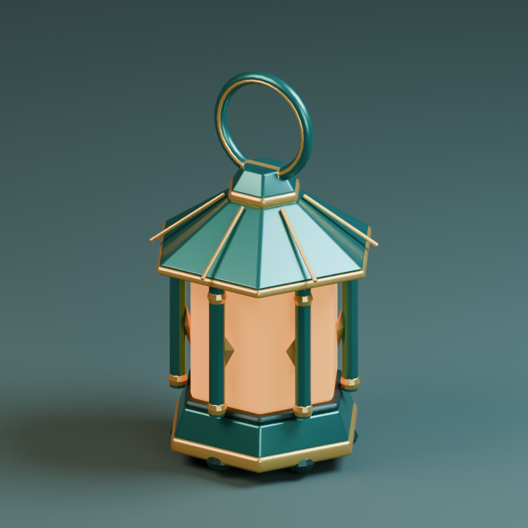
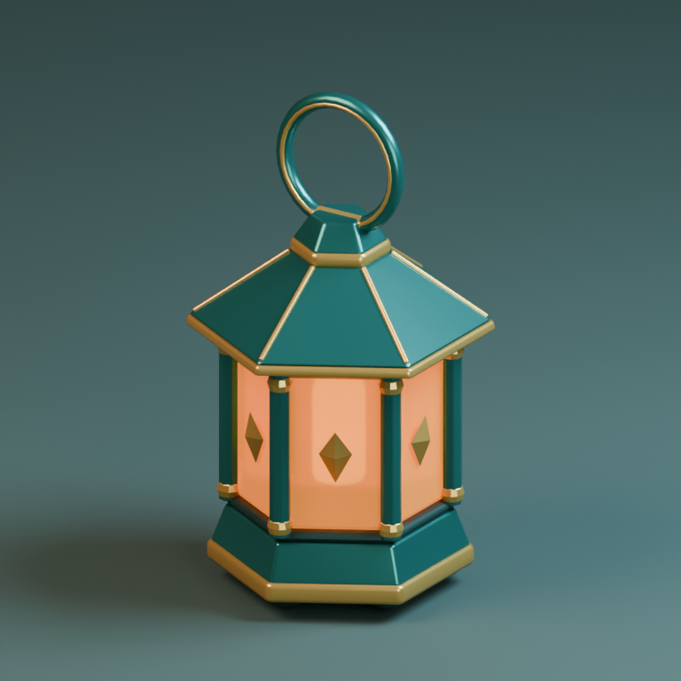
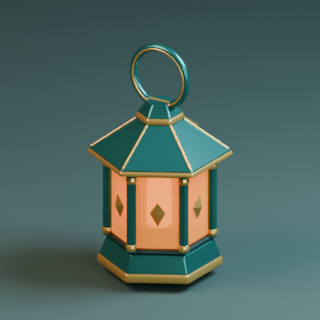

# Blender 製作與驗收實測

日期：2026-11-04。對應 CraftRoster 1.3.0。以下分別記錄套件安裝、執行工具、資產流程與實際視覺審查；不把其中一層的通過推論為所有 Blender 或遊戲引擎均受支援。

## 執行範圍

| 層級 | 實際執行與結果 |
|---|---|
| 分類與依賴 | 10 Skills／2 Agents；入口獨立、專項共用資源、export 的必要 validation 依賴；definitions 3／3 通過 |
| 真實隔離安裝 | Windows PowerShell 5.1 與 7 各 8／8 通過；四種單裝 closure、整包完整資源 hashes、重裝、保留 user file、未寫入全域 |
| Helper 回歸 | Blender 5.2.2 下 16 tests 通過；包括 evaluated modifiers、來源保留、未知／缺漏 scope、NaN 幾何與 transform、過期證據、無效 engine checks |
| 原生 production fixtures | 2／2 通過：骨架動畫 GLB fresh-process roundtrip、正交參考比例修正後匯出與重新匯入 |
| 製作 forward trial | 新的代理依 brief 與 Skills 實作道具，保存 .blend／GLB、渲染、技術檢查與重新匯入結果 |
| 獨立視覺審查 | 另一個 fresh-context 唯讀代理直接查看六張當前來源／decoded 圖；接受其符合本次 brief，保留一項可選藝術偏好 |
| 遠端來源 | 4 repositories、15 唯一固定內容路徑、4 LICENSE 的 commit/tree/blob/license 通過；兩個 Agents 的來源另行核對 |
| 改寫重疊 | 10 Skills 的完整 audit plan（52 個文字檔、60 次比較）與兩個 Agent 比較均無 findings；沿用原有 matcher |

部分 child-process／TEMP 檢查首次遇到 sandbox `EPERM` 或寫入權限限制，允許隔離測試程序執行後完成。這些環境錯誤沒有被記為產品通過或產品失敗。

## 真實畫面修正

Brief：製作適合 cozy fantasy 遊戲的森林燈籠／信標，以深青綠金屬、暖黃銅、琥珀發光玻璃構成，3/4 鏡頭下約 256 pixels 高時仍清楚。沒有提供外部參考圖或指定遊戲引擎；造型與尺寸為本次製作的暫定解讀。

| 第一版 | 第三版 |
|---|---|
|  |  |

1. 第一版實際看圖發現六角 primitive 與屋頂接縫／支柱角度不一致，細桿突出屋頂。第二版修正旋轉，並保留同鏡頭圖片比較。
2. 第二版確認飾片落在錯誤角度、被柱體遮住，玻璃偏向平坦色塊。第三版移至面中心，改善有限的透射及內部光源。
3. 最終來源與 GLB 重新匯入都產生新圖，再由獨立 reviewer 看 beauty、game、back、clay 與 decoded views。沒有重大視覺缺陷；「內部琥珀核心可再明顯一點」屬可選藝術偏好，不強制覆蓋既有風格。

| 最終遊戲鏡頭 | 最終 GLB 重新匯入 |
|---|---|
|  |  |

另有 [背面](back-r3.png)、[clay 診斷圖](clay-r3.png)、[decoded beauty](decoded-beauty-final.png)、[獨立審查紀錄](visual-review.json)與[來源／圖像 hashes](evidence.json)。圖像是直接由 Blender 產生，沒有以修圖隱藏幾何缺陷。

## 證據與限制

- 道具實測為 49 meshes、7,372 evaluated triangles、5 個 material roles；明確範圍的 manifold／材質／預算檢查通過。GLB 重新匯入的 mesh count、material roles、orientation 與 world bounds 符合原契約，尺寸容差為 `1e-5 m`。
- 最終 evidence checker 回傳 `ready: true`、`scope: asset_delivery`；technical／visual 為 pass，engine 為 `not_tested`。hashes 只綁定檔案版本，不會驗證審查者身分或自動證明美感。
- 骨架 fixture 核對 `Root`／`Wave`、1 秒 clip、實際蒙皮變形及尺度；參考 fixture 為合成正交目標，寬高比從 1.0 修正至 0.5。這不等於複雜角色或照片重建已通過。
- 本次原生執行 host 為 Windows，Blender 為 5.2.2 LTS。沒有驗證其他版本、macOS／Linux 原生 Blender、FBX、collision、GPU budgets 或遊戲引擎的材質／動畫實際運行。
- 道具保留可編輯的多物件組裝，尚未作 draw-call 最佳化；尺度與約 1.35 cm 底部留空有記錄。光照與透射依賴 importer 能力，仍須在目標遊戲內確認。
- 完整來源、GLB、腳本與執行 log 保留於本機忽略的 `.work/blender-forward-trial/run-20261104-a/`；GitHub 僅保存這份報告及圖片，並非完整資產重播包。審查結論不代表使用者已核准藝術方向。

## 可重跑的回歸

```powershell
npm run validate
npm run test:blender-series -- --definitions
npm run test:blender-series -- --powershell powershell
python tests/blender-helpers.test.py
$env:BLENDER_BIN = 'C:\path\to\blender.exe'
python tests/blender-helpers.test.py
python tests/blender-production.test.py
```

不設定 `BLENDER_BIN` 時原生檢查會明確 skip，不能把整體 runner 成功解讀為 Blender 已執行。CI 分類、安裝與 host-only helper gates 已納入 workflow；本地結果不代表尚未推送的 GitHub CI 已通過。
