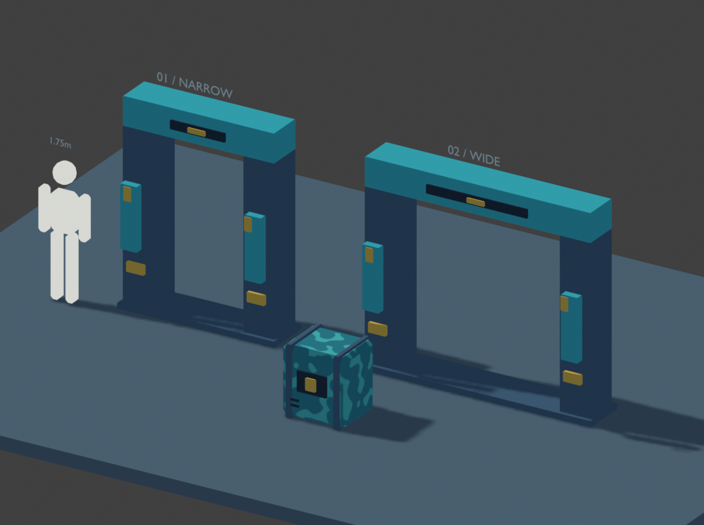

# Blender 1.4.0 擴充驗證

日期：2026-11-04。這是 108 個 Skills 擴充的來源、安裝、工具與代表性製作測試紀錄；**不是全部工作流程、風格或遊戲引擎都已執行通過的聲明**。

## 內容與來源

- 完整閱讀並逐項映射兩份固定來源的 122 個 canonical Skill entries，保留 388 個來源檔案的 path、commit、tree 與 blob 證據；Cursor mirror 不重複計算。
- 整理成 108 個本地 packages，保留初版協調入口。全部有具體製作、失敗修正、交付與驗收說明；詳見 [來源覆蓋清單](../../blender-source-coverage.md) 與 [使用指南](../../blender-skills.md)。
- 二次內容審查發現部分世界／風格子類仍只是概述，補上 21 份世界／類型資源、135 個具名流程段落，以及 8 份風格分支資源。這些數量描述文件範圍，不能單靠字數或段落數證明品質。
- 使用專案原有 originality matcher 比對本系列 108 packages、529 個本地文字檔、319 個 primary pinned source files，完成 1,618 次比對，沒有命中重複片段。主要來源快取逐檔核對 Git blob，其餘保留來源使用固定 revision 讀取；secondary-source 審查另由覆蓋清單記錄。

## 自動與原生檢查

| 檢查 | 結果與界線 |
|---|---|
| `npm run validate` | 通過：catalog、contracts、eval 定義、來源、依賴、用途分類、review registry、release baseline、Blender coverage |
| `test:blender-coverage` | 21 項通過；包含漏映射、遺失資源、錯誤 blob、同步竄改 inventory、路徑與必要配套等反例 |
| `test:blender-series`，Windows PowerShell 5.1 | 9 項通過；獨立安裝、108 Skills／2 Agents 完整 payload、重複更新與原有檔案保留 |
| `test:blender-series`，PowerShell 7 | 同一組 9 項通過，使用另一個隔離暫存專案 |
| `tests/blender-helpers.test.py` | 設定 Blender 5.2.2 後 17 項通過，含原生 evaluated geometry、非有限值、來源保留、空材質槽／實際缺材質及 schema 檢查 |
| `tests/blender-expansion-helpers.test.py` | 21 項：20 通過、1 跳過；含真實子程序、原生 Blender 成功／例外／缺輸出混合批次、timeout 與來源保留。此 Windows host 無法建立 symlink fixture，另有可攜的 symlink-loop 例外回歸 |
| `tests/blender-production.test.py` | 既有 2 個原生案例通過：骨架／動畫 GLB 回讀與參考比例修正，確認共用檢查器變更未破壞既有流程 |
| `npm run test:package` | 實際封裝／解包檢查通過：3,441 個檔案、82 個 declared entrypoints、15 個 manifests |
| 既有來源、依賴、bundle、eval 與 provenance fixture 回歸 | 通過，未放寬來源 pin、唯讀權限或必要依賴規則 |

CI 已接上 coverage 和不需 Blender 的 batch helper 測試；沒有 `BLENDER_BIN` 時原生案例明確 skip。此次沒有推送或執行新的 GitHub CI；Linux／macOS 的實際安裝結果也不由 Windows 測試代替。外部 skill-creator Python quick validator 因缺 PyYAML 未執行；本專案的 Skill validators 已通過。

本系列的 290 個 output evals 是 108 packages 的任務定義，與上述實際執行證據分開；沒有把未跑過的案例標成成功。

## 代表性製作與獨立看圖

獨立製作者收到一般使用者式 brief，依本地 Skills 在隔離 Blender 5.2.2 程序中製作：可調窄／寬科幻門框、穩定種子的面板變化、256×256 色彩烘焙箱子、兩種方向的 cel 打光、尺度代理、診斷圖、GLB 與重新匯入。

交付檔案：[可編輯 Blender 場景](doorway_crate.blend)、[GLB](doorway_crate.glb)、[烘焙色圖](crate_basecolor_256.png)。它們保留當次測試的原始 bytes；來源場景可能保留作者環境路徑，重新使用前需檢查相依資源。現行 revision、所有檔案 hashes 與範圍見 [evidence.json](evidence.json)。

實際執行中發現並修正：

1. Blender 5.2.2 的 Geometry Nodes modifier 輸入使用實際 RNA 路徑，舊 ID-property 寫法失敗；renderer enum 也以本機探測為準。
2. 直接把 field 接到需要單值的 primitive 尺寸，會讓面板塌成零面積。改為明確取樣單值，並檢查各零件三角形面積；整體 bounds 原本漏掉了這個問題。
3. Bevel 大於薄零件可承受厚度時產生退化三角形。縮小局部 bevel 後，最終來源與回讀的九個交付物件皆無此缺陷。
4. 原檢查器把未使用的空材質槽當成缺材質。修正為檢查 evaluated polygon assignments，並增加原生正／反例；最後 [technical-final.json](technical-final.json) 通過九個物件的明確契約。
5. 最小 UV island 間距約 4.418 px，原先雙側 6 px dilation 過大；改為 2 px 並實際重烘焙。保留有效 UV，沒有以重畫 UV 掩蓋測試問題。完整 mip/filter 接受度仍未測試。

第一次獨立 reviewer 實際看圖後提出尺度代理不清楚、PBR 比較條件不一致，以及 checker 邊緣疑點。製作者修正並提供新證據；第二次 reviewer 檢視八張最終圖片後，三項均關閉，接受**所審查的靜態視圖與 Blender PBR 回讀比較**。唯讀 reviewer 沒有修改場景、產生渲染或寫報告；本紀錄由主代理保存其回覆。完整結論見 [visual-review.json](visual-review.json)。

| 證據 | 用途 |
|---|---|
| [左向光](cel_key_left.png)、[右向光](cel_key_right.png) | 輪廓、材質角色、尺度代理與圖像層次 |
| [中性診斷](neutral_diagnostic.png) | 開口、厚度、接地與幾何呈現 |
| [來源 PBR](source_pbr_matched.png)、[回讀 PBR](reimport_pbr_matched.png) | 相同相機、光源、曝光、背景下的可見一致性；最大單色道差 1/255 是輔助量測 |
| [未打光色圖](crate_bake_unlit_crop.png)、[color grid](crate_checker_unlit_colorgrid.png)、[plain checker](crate_checker_unlit_plain.png) | 區分測試圖自身標記、UV 壓縮及實際色彩烘焙缺陷 |

## 尚未證明的範圍

- 沒有 Godot、Unity、Unreal 的實際執行結果；引擎材質、碰撞、LOD、玩法及效能維持未驗證。
- GLB 使用一般 PBR 材質；作者場景的 cel graph 沒有宣稱直接轉成引擎 shader。
- 程序門框只驗證記錄中的尺寸／種子範圍；程式強制設 width=0 會退化，不能把 UI 範圍當成硬性 runtime clamp。
- 此案例沒有驗證 tangent normal baking、lightmap、動態影像穩定性、所有背面、全部子類流程或跨 Blender／OS 版本。
- 檔案 hashes 綁定測試 revision，不能自行判斷藝術品質或驗證 reviewer 身分。數值、圖像審查和引擎接受度持續分開記錄。
